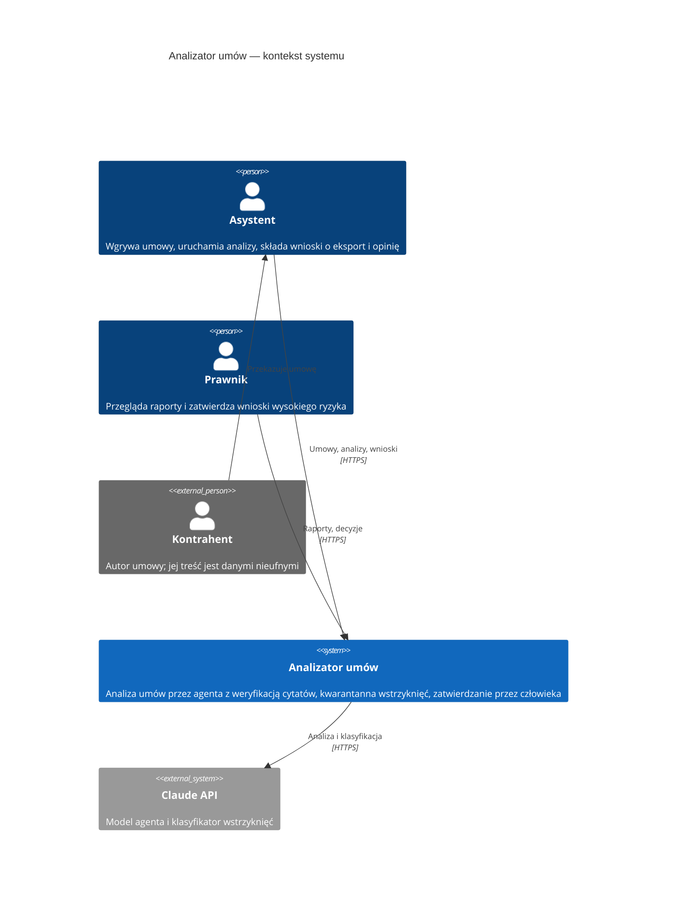

# 3. Kontekst i zakres

## Kontekst biznesowy

| Partner | Wejście do systemu | Wyjście z systemu |
|---|---|---|
| Asystent | tekst umowy i wersji, uruchomienie analizy, wnioski `eksport`/`opinia` | raport ryzyka, porównanie wersji, plik eksportu po zatwierdzeniu |
| Prawnik | decyzje o wnioskach, treść klauzuli przy zatwierdzaniu wzorca | kolejka wniosków, raporty |
| Kontrahent (pośrednio) | treść umowy, w tym potencjalne ukryte instrukcje | — |
| Claude API | odpowiedzi modelu: wywołania narzędzi, wynik klasyfikacji w schemacie JSON | fragmenty umowy jako dane, prompt systemowy |

## Kontekst techniczny

| Kanał | Protokół / format | Uwagi |
|---|---|---|
| Przeglądarka ↔ frontend (nginx) | HTTP(S), statyczne pliki SPA | nagłówek CSP bez `unsafe-inline` |
| Frontend ↔ API | REST/JSON pod `/api`, błędy `problem+json` | sesja w ciasteczku `HttpOnly`, `SameSite=Strict` |
| Backend ↔ PostgreSQL | psycopg 3 | jedyny dostęp do bazy przez moduł `repo/` |
| Backend ↔ Claude API albo Microsoft Foundry | Claude Agent SDK (proces CLI z własnymi narzędziami MCP in-process), Anthropic SDK dla klasyfikatora; dostawcę wybiera `LLM_PROVIDER` ([ADR 0009](../adr/0009-dostawca-modelu-jako-ustawienie.md)) | klucz tylko w zmiennej środowiskowej: `ANTHROPIC_API_KEY` albo `ANTHROPIC_FOUNDRY_API_KEY` |

## Zakres

W zakresie: analiza tekstowych umów najmu, dostawy i zlecenia; wersje i porównania; wykrywanie
wstrzyknięć; wnioski i zatwierdzanie; jedna kancelaria z rolami `asystent` i `prawnik`.

Poza zakresem:

- prawdziwe umowy i dane osobowe;
- PDF/DOCX;
- kolejka zadań;
- wiele kancelarii;
- SSO;
- wdrożenie w chmurze.
