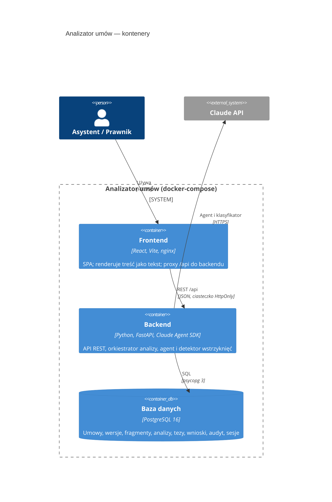
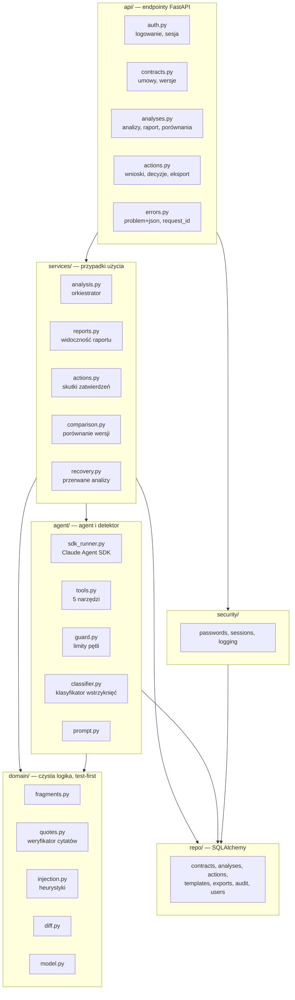

# 5. Widok bloków budujących

## Poziom 1: kontenery

| Kontener | Odpowiedzialność | Kod |
|---|---|---|
| Frontend | logowanie, lista umów, widok dokumentu z adnotacjami, raport ryzyka, porównanie, kolejka wniosków | [`frontend/src/`](../../frontend/src/App.tsx) |
| Backend | API, uwierzytelnianie i role, orkiestracja analizy, agent, detektor, porównania, wnioski | [`backend/app/`](../../backend/app/main.py) |
| Baza danych | trwały stan; schemat w migracji Alembic | [`backend/alembic/`](../../backend/alembic/versions/0001_schemat.py) |

## Poziom 2: komponenty backendu

| Moduł | Odpowiedzialność | Zależy od |
|---|---|---|
| `domain/` | podział na fragmenty, weryfikacja cytatów, heurystyki wstrzyknięć, diff wersji, model tez; bez I/O | — |
| `agent/` | konfiguracja Agent SDK, prompt systemowy, narzędzia, strażnik limitów, klasyfikator, fałszywy runner do testów | `domain`, `repo` |
| `services/` | orkiestracja analizy, widoczność raportu, skutki zatwierdzeń, porównania, sprzątanie po restarcie | `domain`, `agent`, `repo` |
| `repo/` | jedyny dostęp do bazy; funkcje robią `flush`, transakcję zatwierdza wywołujący | PostgreSQL |
| `api/` | endpointy, zależności autoryzacji (`current_user`, `require_role`), mapowanie błędów | `services`, `security` |
| `security/` | argon2, sesje (hash tokenu), redakcja logów | `repo` |

## Poziom 2: komponenty frontendu

| Komponent | Odpowiedzialność |
|---|---|
| `api/client.ts`, `api/types.ts` | `apiFetch` z `credentials: "same-origin"`, `ApiError` z `request_id`, typy odpowiedzi |
| `auth/AuthContext.tsx` | bieżący użytkownik, logowanie, wylogowanie, reakcja na wygasłą sesję |
| `document/segments.ts` | podział tekstu na segmenty w granicach zakresów cytatów |
| `document/DocumentView.tsx`, `RiskReport.tsx`, `useAnalysis.ts` | dokument z podświetleniami, raport, odpytywanie statusu |
| `pages/*` | lista umów, strona umowy, porównanie, kolejka wniosków, logowanie |
