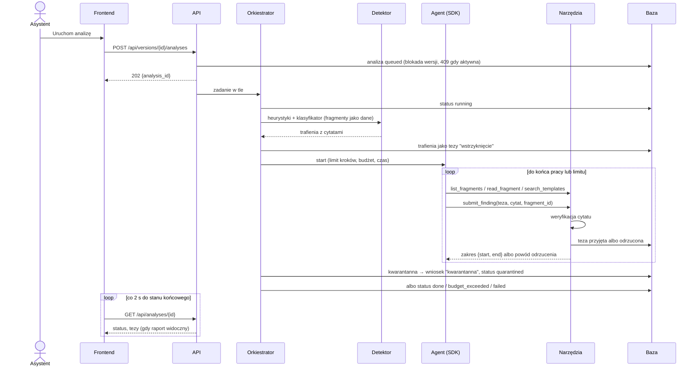
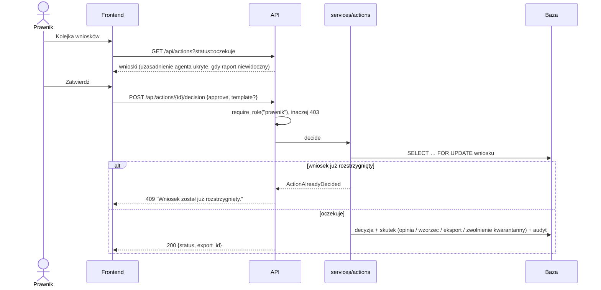

# 6. Widok czasu wykonania

## Scenariusz 1: analiza umowy

Uwagi:

- Agent działa także wtedy, gdy detektor coś znalazł: jest izolowany. Wynik dostaje jednak status
  `quarantined` i pozostaje ukryty do decyzji prawnika.
- Niedostępny klasyfikator również prowadzi do kwarantanny (fail closed).
- Kwarantanna ma pierwszeństwo przed błędem przebiegu agenta. Analiza z wykrytym wstrzyknięciem
  nie staje się widoczna przez status `failed`.
- Po restarcie backendu analizy `queued`/`running` są oznaczane jako `failed`
  (`przerwana_restartem`).

## Scenariusz 2: zatwierdzenie wniosku

Skutki zatwierdzenia:

| Wniosek | Skutek |
|---|---|
| `kwarantanna` | raport staje się widoczny (status `done`) |
| `opinia` | analiza oznaczona jako oficjalna opinia kancelarii |
| `wzorzec` | nowa wersja klauzuli w bazie wzorców; treść pisze prawnik w decyzji |
| `eksport` | plik JSON raportu do pobrania pod `/api/exports/{id}` |

## Scenariusz 3: porównanie wersji

Użytkownik wybiera starą i nową wersję. `POST /api/comparisons` liczy deterministyczny diff
fragmentów według etykiet (dodany, usunięty, zmieniony) oraz, gdy obie wersje mają zakończoną
analizę, zmiany tez (nowe i te, które ustąpiły). Wynik jest zapisywany w tabeli `comparisons`.
