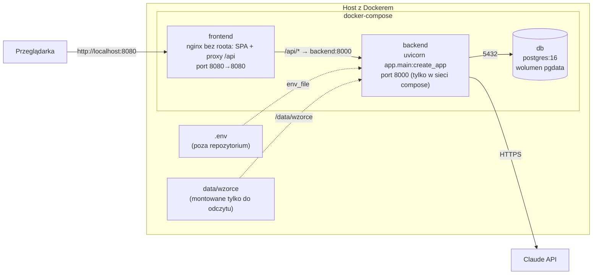

# 7. Widok wdrożenia

## Infrastruktura: docker-compose na jednej maszynie

| Element | Obraz / konfiguracja | Uwagi |
|---|---|---|
| `db` | `postgres:16`, wolumen `pgdata`, healthcheck `pg_isready` | backend startuje po `service_healthy` |
| `backend` | `backend/Dockerfile`: Python 3.14, `uv sync --frozen --no-dev`, użytkownik bez uprawnień `appuser`; zawiera `alembic.ini` i migracje; przy starcie `alembic upgrade head`, potem uvicorn | konfiguracja z `.env`; wzorce klauzul z `data/wzorce` montowanych tylko do odczytu; `restart: unless-stopped` |
| `frontend` | `frontend/Dockerfile`: build Vite, serwowany przez `nginx-unprivileged` (bez roota, port 8080) | CSP, proxy `/api/` do `backend:8000` z nagłówkiem `Host` zawierającym port, limit ciała 1 MB, limit logowania 10/min na IP |

## Uruchomienie

Pełna instrukcja jest w [README](../../README.md). W skrócie:

1. `cp .env.example .env` i uzupełnienie danych logowania dostawcy modelu (`ANTHROPIC_API_KEY` albo ustawień Foundry) oraz haseł.
2. `docker compose up -d --build` — backend przy starcie wykonuje migracje.
3. `docker compose exec backend python -m app.repo.seed` — wzorce klauzul i konta demo.

Migracje muszą poprzedzać start aplikacji, bo przy starcie oznacza ona przerwane analizy jako
`failed`, a do tego potrzebuje tabeli `analyses`.

## Konfiguracja

Wszystkie ustawienia pochodzą ze zmiennych środowiskowych ([`.env.example`](../../.env.example)):

- połączenie z bazą;
- dostawca modelu (`LLM_PROVIDER`: Claude API albo Microsoft Foundry) i jego dane logowania;
- modele;
- limity agenta;
- maksymalna długość umowy i rozmiar ciała żądania;
- limit analiz trwających jednocześnie (`MAX_ACTIVE_ANALYSES`);
- czas życia sesji;
- `COOKIE_SECURE` (`true` za TLS);
- poziom logów;
- hasła kont demo.

## Ograniczenia wdrożenia

- Jeden proces backendu. Analizy działają w tle tego procesu, a sprzątanie po restarcie zakłada
  brak drugiej instancji ([ADR 0007](../adr/0007-zadania-w-tle-bez-kolejki.md)).
- Brak TLS w compose. Produkcja wymaga reverse proxy z TLS i `COOKIE_SECURE=true`.
- Backend nie jest wystawiony na hosta: jedynym wejściem jest nginx, który dodaje CSP i limity.
  Reverse proxy przed nginx musi przekazywać nagłówek `Host` bez zmian, bo backend porównuje
  z nim nagłówek `Origin`. Musi też ustawiać `X-Forwarded-For`, a w
  [`frontend/nginx.conf`](../../frontend/nginx.conf) trzeba odkomentować `set_real_ip_from`
  (sieć proxy) i `real_ip_header`. Bez tego limit logowania liczy adres proxy i wszyscy
  użytkownicy dzielą jeden limit 10 prób na minutę.
- Obrazy bazowe są przypięte po digeście (`python:3.14-slim`, `uv` także po wersji, `node:24-alpine`,
  `nginx-unprivileged`);
  aktualizacje proponuje Dependabot.
- CI (GitHub Actions) uruchamia testy backendu z PostgreSQL jako service container.
