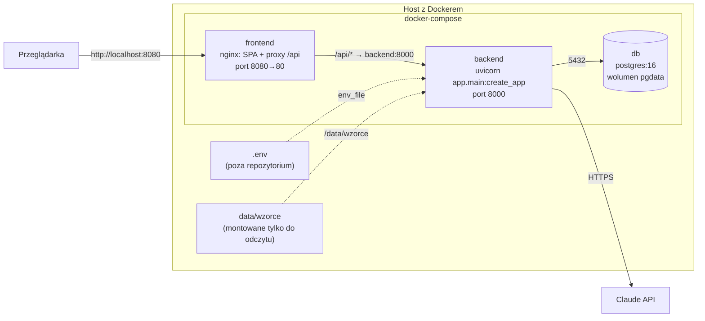

# 7. Widok wdrożenia

## Infrastruktura: docker-compose na jednej maszynie

| Element | Obraz / konfiguracja | Uwagi |
|---|---|---|
| `db` | `postgres:16`, wolumen `pgdata`, healthcheck `pg_isready` | backend startuje po `service_healthy` |
| `backend` | `backend/Dockerfile`: Python 3.12, `uv sync --frozen --no-dev`, użytkownik bez uprawnień `appuser`; zawiera `alembic.ini` i migracje | konfiguracja z `.env`; wzorce klauzul z `data/wzorce` montowanych tylko do odczytu |
| `frontend` | `frontend/Dockerfile`: build Vite, serwowany przez nginx | CSP, proxy `/api/` do `backend:8000` |

## Uruchomienie

Pełna instrukcja jest w [README](../../README.md). W skrócie:

1. `cp .env.example .env` i uzupełnienie `ANTHROPIC_API_KEY` oraz haseł.
2. `docker compose up -d --build`.
3. `docker compose exec backend alembic upgrade head` — migracje.
4. `docker compose exec backend python -m app.repo.seed` — wzorce klauzul i konta demo.

## Konfiguracja

Wszystkie ustawienia pochodzą ze zmiennych środowiskowych ([`.env.example`](../../.env.example)):

- połączenie z bazą;
- klucz Anthropic;
- modele;
- limity agenta;
- maksymalna długość umowy;
- czas życia sesji;
- `COOKIE_SECURE` (`true` za TLS);
- poziom logów;
- hasła kont demo.

## Ograniczenia wdrożenia

- Jeden proces backendu. Analizy działają w tle tego procesu, a sprzątanie po restarcie zakłada
  brak drugiej instancji ([ADR 0007](../adr/0007-zadania-w-tle-bez-kolejki.md)).
- Brak TLS w compose. Produkcja wymaga reverse proxy z TLS i `COOKIE_SECURE=true`.
- CI (GitHub Actions) uruchamia testy backendu z PostgreSQL jako service container.
