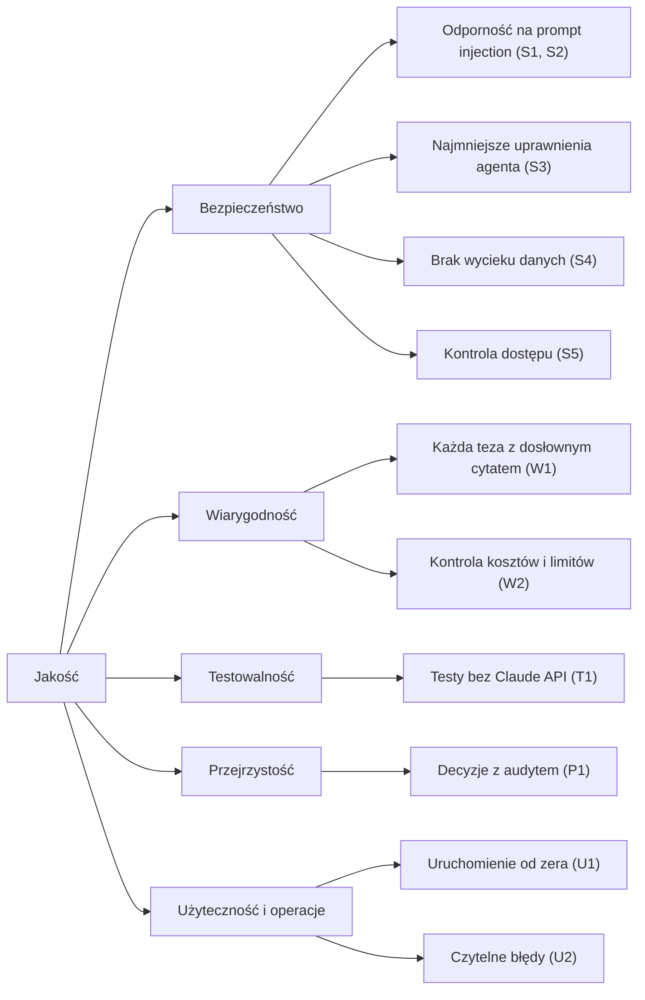

# 10. Wymagania jakościowe

## Drzewo jakości

## Scenariusze jakościowe

| ID | Bodziec | Reakcja systemu | Miara |
|---|---|---|---|
| S1 | Asystent wgrywa umowę z jawnym poleceniem dla AI | Detektor zgłasza trafienie, analiza kończy się statusem `quarantined`, raport ukryty | każdy wariant z korpusu `data/umowy_z_wstrzyknieciem` → `quarantined` (testy i `eval_live.py`) |
| S2 | Instrukcja ukryta znakami zero-width lub pseudo-znacznikiem `</document>` | Heurystyka wykrywa wariant, znaczniki w `read_fragment` są neutralizowane | testy heurystyk dla każdego wariantu |
| S3 | Model próbuje użyć Bash lub odczytać inną umowę | Narzędzie niedostępne; zestaw spoza listy przerywa przebieg | 0 wbudowanych narzędzi w opcjach SDK; test izolacji wersji |
| S4 | Wyjątek podczas analizy umowy z danymi osobowymi | Status `failed` z nazwą klasy wyjątku; w logach i odpowiedzi brak treści umowy | test logów i odpowiedzi błędu |
| S5 | Asystent wysyła decyzję o wniosku | 403, brak skutku i wpisu decyzji | test API |
| W1 | Agent zgłasza parafrazę zamiast cytatu | Teza odrzucona (`brak_dosłownego_cytatu`), zapisana w `rejected_claims`, nie trafia do raportu | 100% tez w raporcie ma cytat obecny dosłownie w tekście (test i `eval_live.py`) |
| W2 | Agent wpada w pętlę | Przerwanie po `AGENT_MAX_TURNS` lub `AGENT_MAX_BUDGET_USD`, status `budget_exceeded` | koszt jednej analizy ≤ `AGENT_MAX_BUDGET_USD` (domyślnie 0,50 USD) |
| T1 | Uruchomienie CI na pull requeście | Wszystkie testy przechodzą bez klucza API | CI bez `ANTHROPIC_API_KEY` |
| P1 | Dwóch prawników zatwierdza ten sam wniosek równocześnie | Jeden skutek, jeden wpis audytu, drugi dostaje 409 | test wyścigu na dwóch połączeniach |
| U1 | Nowy członek zespołu klonuje repozytorium | Aplikacja działa po krokach z README | `docker compose up` + migracje + seed, logowanie kontem demo |
| U2 | Błąd serwera podczas pracy w przeglądarce | Komunikat z tytułem i `request_id` do zgłoszenia | każdy błąd API w UI zawiera `request_id` |
