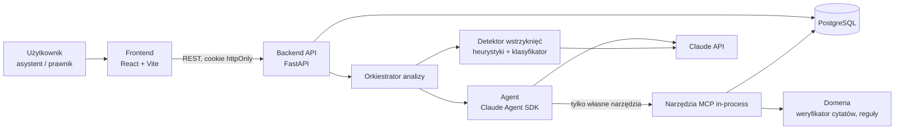
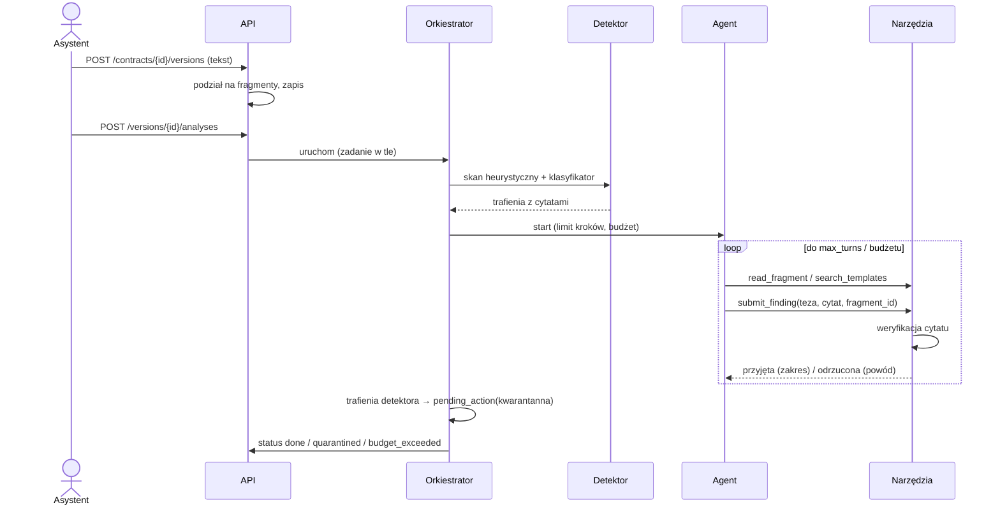

# Analizator umów — specyfikacja projektu

Data: 2026-10-15 · Status: do przeglądu

## 1. Cel i zakres

Aplikacja dla **fikcyjnej kancelarii** analizuje **syntetyczne** umowy najmu, dostawy i zlecenia.
Agent zbudowany na Claude Agent SDK wyodrębnia strony, terminy i kary umowne, porównuje klauzule
z bazą wzorców i oznacza zapisy ryzykowne z uzasadnieniem. Backend przechowuje wersje umów,
analizy i porównania; frontend pokazuje dokument z adnotacjami i raport ryzyka.

**Wyróżnik bezpieczeństwa:** umowa od kontrahenta jest danymi nieufnymi. System wykrywa ukryte
instrukcje (prompt injection), a każda teza agenta musi wskazywać dokładny cytat z dokumentu,
weryfikowany automatycznie po stronie serwera. Tezy bez dosłownego oparcia są odrzucane.

### Wymagania (od użytkownika)

- Agent na Claude Agent SDK z własnymi narzędziami.
- Full-stack: backend API, frontend dla użytkownika, trwałe dane w bazie.
- Bezpieczeństwo agenta: dane wejściowe nieufne (obrona przed prompt injection), najmniejsze
  uprawnienia narzędzi, zatwierdzanie przez człowieka akcji wysokiego ryzyka, limity budżetu
  i liczby kroków pętli, brak wycieku danych.
- Git, testy automatyczne, **test-first dla logiki domenowej**.
- CI na każdym pull requeście: lint, typecheck, testy.
- Przeglądy kodu widoczne w pull requestach.
- Brak sekretów w repozytorium; konfiguracja przez zmienne środowiskowe.
- README z instrukcją uruchomienia od zera.
- Krótkie ADR dla kluczowych decyzji.
- Obsługa błędów i logowanie.
- Model zagrożeń dla aplikacji i agenta.
- Dokumentacja arc42 w `docs/arc42/`: wszystkie 12 sekcji wypełnione treścią adekwatną do
  projektu, diagramy tekstowe (Mermaid / C4), wygenerowana z pomocą agenta i zweryfikowana przez
  zespół.

### Ustalenia z brainstormingu

| Temat | Decyzja |
|---|---|
| Repozytorium | nowe, publiczne: `DanielLuba86/analizator-umow` |
| Stack | backend Python (FastAPI, Claude Agent SDK, SQLAlchemy, Alembic), frontend React + Vite + TypeScript |
| Baza i wdrożenie | PostgreSQL w docker-compose (db, backend, frontend) |
| Użytkownicy | logowanie, role `asystent` i `prawnik`, sesja w ciasteczku httpOnly |
| Akcje wysokiego ryzyka | wszystkie cztery: oficjalna opinia, zmiana bazy wzorców, eksport raportu, odblokowanie kwarantanny |
| Mechanizm tez | podejście A: tezy zgłaszane narzędziem `submit_finding`, weryfikacja cytatu w kodzie serwera |

### Poza zakresem

- Prawdziwe umowy i dane osobowe; porady prawne.
- Wgrywanie PDF/DOCX (wejściem jest tekst / Markdown).
- Kolejka zadań (Celery, Redis), wielodostępność wielu kancelarii, SSO/OIDC.
- Wdrożenie produkcyjne w chmurze (wdrożenie docelowe = docker-compose).

## 2. Architektura



### Moduły backendu (`backend/app/`)

| Moduł | Odpowiedzialność | Zależy od |
|---|---|---|
| `domain/` | podział na fragmenty, weryfikator cytatów, heurystyki wstrzyknięć, diff wersji, model tez i ryzyk; czysty Python bez I/O, **test-first** | — |
| `agent/` | konfiguracja Agent SDK, prompt systemowy, narzędzia, limity, adapter modelu (prawdziwy / fałszywy) | `domain`, `repo` |
| `services/` | orkiestracja analizy, wersjonowanie, porównania, obsługa `pending_action` | `domain`, `agent`, `repo` |
| `repo/` | SQLAlchemy + Alembic; jedyne miejsce z dostępem do bazy | PostgreSQL |
| `api/` | endpointy FastAPI, autoryzacja ról, mapowanie błędów na `problem+json` | `services`, `security` |
| `security/` | hashowanie haseł (argon2), sesje, audyt, redakcja logów | `repo` |
| `config.py` | ustawienia z zmiennych środowiskowych (pydantic-settings) | — |

Zależności idą tylko w dół tabeli; `domain` nie importuje niczego z projektu.

### Narzędzia agenta (najmniejsze uprawnienia)

Wbudowane narzędzia SDK (Bash, pliki, web) są **wyłączone** (`allowed_tools` zawiera wyłącznie
poniższe). `analysis_id` i `version_id` narzędzia biorą z kontekstu serwera, nigdy z argumentów
modelu — agent nie może sięgnąć do innej umowy.

| Narzędzie | Uprawnienie | Zwraca |
|---|---|---|
| `list_fragments()` | odczyt fragmentów bieżącej wersji | lista `{id, etykieta, długość}` |
| `read_fragment(fragment_id)` | odczyt jednego fragmentu bieżącej wersji | tekst w `<untrusted_contract_fragment id=…>…</untrusted_contract_fragment>` |
| `search_templates(rodzaj, zapytanie)` | odczyt bazy wzorców | pasujące klauzule wzorcowe |
| `submit_finding(typ, teza, cytat, fragment_id, poziom_ryzyka?, uzasadnienie, template_id?)` | zapis tezy **po weryfikacji cytatu** | `przyjęta {start, end}` lub `odrzucona {powód}` |
| `request_action(typ, uzasadnienie)` | utworzenie wniosku `pending_action`; nic nie wykonuje | id wniosku |

### Weryfikacja cytatów (rdzeń domeny)

- Cytat jest przyjęty, gdy występuje **dosłownie** we wskazanym fragmencie po normalizacji
  wyłącznie białych znaków (ciągi spacji, tabulatorów, nowych linii i twardych spacji → jedna
  spacja). Wielkość liter, interpunkcja, cudzysłowy i myślniki muszą się zgadzać.
- Minimalna długość cytatu: 12 znaków po normalizacji (chroni przed cytatami typu „§ 1”).
- Wynik przyjęcia zawiera zakres znaków `start, end` w oryginalnym tekście wersji (mapowanie
  z tekstu znormalizowanego na oryginał), używany przez frontend do podświetlenia.
- Cytat występujący w fragmencie kilka razy wskazuje pierwsze wystąpienie.
- Odrzucone tezy trafiają do `rejected_claims` z powodem (`brak_dosłownego_cytatu`,
  `zły_fragment`, `za_krótki_cytat`, `limit_tez`) i nigdy do raportu.

## 3. Model danych

| Tabela | Kluczowe pola |
|---|---|
| `users` | id, login, password_hash, role (`asystent`/`prawnik`) |
| `contracts` | id, tytuł, rodzaj (`najem`/`dostawa`/`zlecenie`), źródło (`wewnętrzna`/`kontrahent`), created_by |
| `contract_versions` | id, contract_id, nr, treść, sha256, created_at — wersje niezmienne |
| `fragments` | id, version_id, etykieta (np. „§ 4 ust. 2”), start, end — deterministycznie przy wgraniu |
| `analyses` | id, version_id, status, model, liczba_kroków, koszt_usd, started_by, started_at, finished_at |
| `findings` | id, analysis_id, typ (`strona`/`termin`/`kara`/`ryzyko`/`wstrzyknięcie`), teza, cytat, fragment_id, start, end, poziom_ryzyka, uzasadnienie, template_id |
| `rejected_claims` | jak `findings` + powód odrzucenia |
| `templates` | id, rodzaj, nazwa_klauzuli, treść, wersja |
| `comparisons` | id, version_a, version_b, różnice fragmentów (JSON), zmiany tez (JSON) |
| `pending_actions` | id, typ (`opinia`/`wzorzec`/`eksport`/`kwarantanna`), analysis_id, payload, status (`oczekuje`/`zatwierdzona`/`odrzucona`), decided_by, decided_at |
| `audit_log` | id, user_id, akcja, obiekt, kiedy — tylko dopisywanie |

Statusy analizy: `queued`, `running`, `done`, `failed`, `quarantined`, `budget_exceeded`.

## 4. Przepływ analizy



- Analiza działa jako zadanie w tle (FastAPI `BackgroundTasks`), stan w tabeli `analyses`;
  frontend odpytuje status.
- Gdy detektor coś znajdzie, agent i tak działa (bo jest izolowany), ale wynik ma status
  `quarantined` i jest niewidoczny jako raport, dopóki prawnik nie zatwierdzi wniosku
  `kwarantanna`.
- **Porównanie wersji** jest deterministyczne (diff fragmentów + zmiany tez dwóch analiz), bez LLM.

### Akcje wysokiego ryzyka (człowiek w pętli)

| Wniosek | Kto tworzy | Skutek po zatwierdzeniu przez `prawnik` |
|---|---|---|
| `opinia` | agent (`request_action`) lub asystent | analiza oznaczona jako oficjalna opinia kancelarii |
| `wzorzec` | agent | nowa wersja klauzuli w `templates` |
| `eksport` | asystent | wygenerowanie pliku raportu do pobrania |
| `kwarantanna` | orkiestrator (trafienie detektora) | raport zostaje odblokowany |

Rola `asystent` nie może zatwierdzać (sprawdzane w `api/` i testowane). Każda decyzja trafia do
`audit_log`.

## 5. Bezpieczeństwo agenta

1. **Detekcja przed agentem** — heurystyki w `domain/` (frazy rozkazowe kierowane do AI, znaki
   zero-width i bidi, homoglify, pseudo-znaczniki `</document>` / `system:`, bloki base64) +
   klasyfikator: osobne wywołanie Claude bez narzędzi, dokument jako dane, odpowiedź w ścisłym
   schemacie JSON. Każde trafienie musi mieć zweryfikowany cytat (ten sam weryfikator).
2. **Spotlighting** — treść umowy trafia do agenta wyłącznie przez narzędzia, w znacznikach
   `<untrusted_contract_fragment>`; prompt systemowy deklaruje ich zawartość jako dane.
   Znaczniki występujące w samej treści są neutralizowane przed opakowaniem.
3. **Ograniczenie skutków** — agent ma tylko odczyt jednej umowy, zgłaszanie tez i wnioski.
4. **Weryfikacja cytatów** — fałszywe tezy podsunięte przez atakującego nie przejdą bez
   dosłownego cytatu.
5. **Człowiek w pętli** — cztery wnioski z sekcji 4.
6. **Limity** (zmienne środowiskowe): `AGENT_MAX_TURNS=30`, `AGENT_MAX_BUDGET_USD=0.50`,
   `AGENT_MAX_FINDINGS=60`, `AGENT_TIMEOUT_S=300`. Przekroczenie → `budget_exceeded`
   z dotychczasowymi zweryfikowanymi tezami oznaczonymi jako niepełne.
7. **Brak wycieku danych** — treść umów nie trafia do logów (logi zawierają ID, liczniki,
   hashe; filtr redakcji testowany); eksport wyłącznie po zatwierdzeniu; frontend renderuje tekst
   umowy i agenta jako czysty tekst (bez HTML/markdownu), z nagłówkami CSP; sekrety tylko w `.env`
   (w `.gitignore`), w repo `.env.example`, gitleaks w CI.

**Model zagrożeń** (`docs/threat-model.md`, STRIDE + OWASP Top 10 for LLM Applications):
wstrzyknięcie przez umowę, nadużycie narzędzi, eskalacja roli, wyciek przez logi i eksport,
DoS kosztowy, XSS, przejęcie sesji, sekrety w repo. Każde zagrożenie → mechanizm obrony → test.

**Korpus testów bezpieczeństwa:** w `data/` warianty syntetycznych umów z ukrytymi instrukcjami
(jawne polecenie, zero-width, homoglify, pseudo-znaczniki, instrukcja w załączniku). Testy
sprawdzają: wykrycie, kwarantannę, brak niezweryfikowanych tez w raporcie.

## 6. Obsługa błędów i logowanie

- Wyjątki domenowe (`QuoteNotFound`, `BudgetExceeded`, `Forbidden`, `NotFound`,
  `ConflictVersion`) mapowane w jednym miejscu na kody HTTP i `application/problem+json`, bez
  śladów stosu i treści umowy.
- Błędy Claude API (timeout, 429, 5xx): ograniczone ponowienia z backoffem; po wyczerpaniu
  `failed` z kodem przyczyny, zweryfikowane tezy zachowane.
- Logi strukturalne JSON na stdout z `request_id` i `analysis_id`; kroki agenta logowane bez
  argumentów z treścią. Frontend pokazuje komunikat i `request_id`.

## 7. Testy i CI

| Poziom | Zakres | Narzędzia |
|---|---|---|
| Domena (**test-first**) | fragmenty, weryfikator cytatów, heurystyki wstrzyknięć, diff, reguły ryzyka; przypadki brzegowe (polskie znaki, twarde spacje, myślniki, cytat przez granicę fragmentu) | pytest |
| Narzędzia agenta | odrzucanie złych cytatów, izolacja umów, `request_action` bez skutków | pytest + baza testowa |
| Agent | pętla z fałszywym modelem odtwarzającym scenariusze, limity kroków i budżetu | pytest, bez sieci |
| API | autoryzacja ról, przepływy end-to-end | pytest + httpx, Postgres jako service container |
| Frontend | podświetlanie zakresów, kolejka zatwierdzeń, renderowanie jako tekst | Vitest + Testing Library |
| Ewaluacja na żywo (ręcznie, poza CI) | prawdziwy Claude na korpusie syntetycznym | skrypt `scripts/eval_live.py` |

**CI (GitHub Actions, każdy PR):** ruff (lint + format), mypy `--strict`, eslint, `tsc --noEmit`,
pytest, vitest, gitleaks. Ochrona `main`: wymagane zielone CI i review w PR; szablon PR
z listą kontrolną.

## 8. Struktura repozytorium

```
backend/    app/{domain,agent,services,repo,api,security}, tests/, alembic/, pyproject.toml
frontend/   src/, tests/, package.json
data/       umowy syntetyczne (+ warianty z wstrzyknięciami), wzorce klauzul (seed)
docs/
  arc42/    01-wprowadzenie-i-cele.md … 12-slownik.md
  adr/      0001-….md (MADR, krótkie)
  threat-model.md
  superpowers/specs/, superpowers/plans/
docker-compose.yml, .env.example, README.md
.github/workflows/ci.yml, .github/pull_request_template.md
```

## 9. Dokumentacja

**ADR (MADR):**
1. Podział Python (FastAPI) + React.
2. Claude Agent SDK z własnymi narzędziami MCP in-process.
3. Tezy przez narzędzie z deterministyczną weryfikacją cytatów.
4. Wykrywanie wstrzyknięć jako osobny etap przed agentem.
5. Wnioski `pending_action` zamiast narzędzi wykonawczych.
6. PostgreSQL w docker-compose.
7. Zadania w tle bez zewnętrznej kolejki.
8. Sesje w ciasteczku httpOnly i dwie role.

**arc42** (`docs/arc42/`, 12 plików): 1 wprowadzenie i cele, 2 ograniczenia, 3 kontekst i zakres,
4 strategia rozwiązania, 5 widok bloków budujących, 6 widok czasu wykonania, 7 wdrożenie,
8 koncepcje przekrojowe (w tym bezpieczeństwo agenta), 9 decyzje (linki do ADR), 10 wymagania
jakościowe (drzewo jakości + scenariusze), 11 ryzyka i dług techniczny, 12 słownik. Diagramy
w Mermaid (C4 przez `C4Context` / `C4Container`). Szkic przygotowuje agent; weryfikacja w PR
przez zespół, adnotacja w sekcji 1.

**README:** wymagania wstępne, `cp .env.example .env`, `docker compose up`, migracje i seed,
konta demo, uruchomienie testów, linki do arc42, ADR i modelu zagrożeń.

## 10. Etapy realizacji (każdy = gałąź + PR z review)

1. Szkielet repo, CI, docker-compose, README, ADR 1 i 6.
2. Domena test-first: fragmenty, weryfikator cytatów, heurystyki wstrzyknięć, diff.
3. Baza, repozytoria, auth z rolami, audyt.
4. Agent: narzędzia, limity, fałszywy model w testach, detektor-klasyfikator.
5. API: umowy, wersje, analizy, porównania, wnioski i zatwierdzanie.
6. Frontend.
7. Model zagrożeń, pełne arc42, pozostałe ADR, README od zera.

## 11. Kryteria sukcesu

- `docker compose up` na czystej maszynie + kroki z README dają działającą aplikację z kontami demo.
- Analiza każdej umowy z korpusu daje raport, w którym **każda** teza ma cytat obecny dosłownie
  w dokumencie (sprawdzane testem).
- Każdy wariant z ukrytą instrukcją z korpusu kończy się statusem `quarantined`.
- Asystent nie może zatwierdzić wniosku (test API zwraca 403).
- Przekroczenie limitu kroków lub budżetu kończy analizę statusem `budget_exceeded` (test z fałszywym modelem).
- CI zielone na każdym PR; brak sekretów (gitleaks); 12 sekcji arc42 i 8 ADR w repo.
