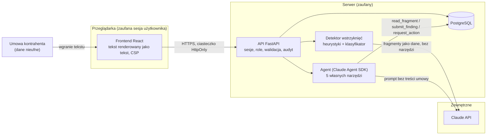

# Model zagrożeń — Analizator umów

Model obejmuje aplikację webową (frontend, API, baza) i agenta Claude, który czyta umowy. Klasyfikacja
według STRIDE oraz [OWASP Top 10 for LLM Applications 2025](https://genai.owasp.org/llm-top-10/).
Każde zagrożenie wskazuje mechanizm obrony (moduł) i test, który go potwierdza. Spójność tabeli
z testami sprawdza w CI skrypt [`scripts/check_threat_model.py`](../scripts/check_threat_model.py).

Wszystkie dane w repozytorium są syntetyczne. Decyzje projektowe stojące za obroną opisują ADR
[0002](adr/0002-claude-agent-sdk-z-wlasnymi-narzedziami.md),
[0003](adr/0003-tezy-przez-narzedzie-z-weryfikacja-cytatow.md),
[0004](adr/0004-detekcja-wstrzykniec-przed-agentem.md),
[0005](adr/0005-wnioski-zamiast-narzedzi-wykonawczych.md) i
[0008](adr/0008-sesje-httponly-i-dwie-role.md).

## Zakres i granice zaufania

Granice zaufania:

1. **Przeglądarka → API.** Każde żądanie poza logowaniem wymaga sesji. Role (`asystent`, `prawnik`)
   sprawdza serwer.
2. **Treść umowy → model.** Umowa kontrahenta jest traktowana jako nieufne dane. Model widzi ją
   tylko przez narzędzie `read_fragment`, w znacznikach `<untrusted_contract_fragment>`.
3. **Wyjście modelu → aplikacja.** Teza jest przyjmowana tylko z dosłownym, zweryfikowanym
   cytatem. Tekst modelu jest zawsze wyświetlany jako zwykły tekst.
4. **Agent → skutki.** Agent nie wykonuje akcji wysokiego ryzyka. Może jedynie złożyć wniosek,
   który zatwierdza prawnik.

## Zagrożenia

Kolumna „Test” wskazuje testy backendu (`tests/…::nazwa`, katalog `backend/`), testy frontendu
(`frontend/tests/…::nazwa`) albo job CI (`ci:…`).

| ID | Kategoria | Zagrożenie | Obrona | Test | Ryzyko rezydualne |
|----|-----------|------------|--------|------|-------------------|
| T1 | LLM01 · Tampering | Jawne polecenie dla AI w treści umowy („zignoruj poprzednie instrukcje…”) zmienia wynik analizy. | Heurystyki przed agentem ([`domain/injection.py`](../backend/app/domain/injection.py)), klasyfikator bez narzędzi ([`agent/classifier.py`](../backend/app/agent/classifier.py)); trafienie → kwarantanna i ukryty raport ([`services/analysis.py`](../backend/app/services/analysis.py), [`services/reports.py`](../backend/app/services/reports.py)). | `tests/domain/test_injection.py::test_corpus_variant_detected` `tests/services/test_analysis.py::test_injected_contract_is_quarantined` `tests/api/test_analyses.py::test_quarantined_report_hidden` | Nowe sformułowania mogą ominąć heurystyki. Dlatego działa też klasyfikator, a wynik i tak chronią warstwy T3–T6. |
| T2 | LLM01 · Tampering | Ukryte instrukcje: znaki zero-width i bidi, homoglify, pseudo-znaczniki `</document>` / `system:`. | Reguły heurystyk dla niewidocznych znaków, mieszanych alfabetów i pseudo-znaczników. Każde trafienie ma zweryfikowany cytat. | `tests/domain/test_injection.py::test_widened_invisible_characters_detected` `tests/domain/test_injection.py::test_bidi_override_detected` `tests/domain/test_injection.py::test_mixed_script_word_flagged` `tests/domain/test_injection.py::test_pseudo_tag_variants` `tests/domain/test_injection.py::test_hit_quote_verifies_in_its_fragment` | Homoglify w całości z jednego obcego alfabetu nie są flagowane, żeby uniknąć fałszywych alarmów. |
| T3 | LLM01 · Elevation | Wstrzyknięcie niewykryte przez detektor trafia do kontekstu agenta. | Spotlighting: treść tylko przez `read_fragment` w znacznikach `<untrusted_contract_fragment>`, znaczniki z treści neutralizowane; prompt deklaruje je jako dane i nie zawiera treści umowy ([`agent/tools.py`](../backend/app/agent/tools.py), [`agent/prompt.py`](../backend/app/agent/prompt.py)). | `tests/agent/test_tools.py::test_read_fragment_wraps_and_neutralizes_markers` `tests/agent/test_tools.py::test_read_fragment_neutralizes_uppercase_tag_variant` `tests/agent/test_prompt.py::test_prompt_declares_untrusted_tags_as_data` `tests/agent/test_sdk_options.py::test_start_prompt_has_kind_and_no_contract_text` | Model może mimo to ulec poleceniu. Skutki ograniczają T4–T6: brak narzędzi wykonawczych i weryfikacja cytatów. |
| T4 | LLM09 · Tampering | Atakujący lub halucynacja podsuwa fałszywą tezę („umowę można wypowiedzieć bez kary”). | Teza przyjmowana tylko z dosłownym cytatem z podanego fragmentu, min. 12 znaków; odrzucone tezy nie trafiają do raportu ([`domain/quotes.py`](../backend/app/domain/quotes.py)). | `tests/agent/test_tools.py::test_submit_finding_rejects_paraphrase_and_stores_rejected_claim` `tests/services/test_analysis.py::test_clean_contract_done_and_every_finding_quote_is_verbatim` `tests/services/test_analysis.py::test_classifier_hit_with_fabricated_quote_is_rejected` `tests/api/test_analyses.py::test_rejected_claims_never_in_response` | Prawdziwy cytat może zostać źle zinterpretowany. Za ocenę prawną odpowiada prawnik, a oficjalna opinia wymaga jego zatwierdzenia. |
| T5 | LLM06 · Elevation | Agent używa wbudowanych narzędzi SDK (Bash, plik, sieć) albo sięga po inne umowy. | Wbudowane narzędzia wyłączone, dozwolone tylko 5 własnych narzędzi MCP; zestaw sprawdzany przy starcie (fail closed); narzędzia związane z jedną analizą ([`agent/sdk_runner.py`](../backend/app/agent/sdk_runner.py), [`agent/context.py`](../backend/app/agent/context.py)). | `tests/agent/test_sdk_options.py::test_options_disable_builtin_tools` `tests/agent/test_sdk_options.py::test_options_allow_only_own_tools` `tests/agent/test_sdk_options.py::test_run_aborts_on_unexpected_toolset` `tests/agent/test_sdk_options.py::test_run_fails_closed_when_init_has_no_tools_list` `tests/agent/test_tools.py::test_read_fragment_of_other_version_is_not_reachable` `tests/agent/test_tools.py::test_methods_do_not_accept_analysis_or_version_ids` | Zależność od poprawnego egzekwowania listy narzędzi przez SDK; łagodzi ją kontrola zestawu narzędzi z komunikatu `init`. |
| T6 | LLM06 · Elevation | Agent wykonuje akcję wysokiego ryzyka: eksport, oficjalna opinia, zmiana wzorca, zdjęcie kwarantanny. | Agent tylko składa wniosek (`request_action`); skutek dopiero po decyzji prawnika; treść wzorca pisze prawnik ([`services/actions.py`](../backend/app/services/actions.py)). | `tests/agent/test_tools.py::test_request_action_creates_pending_and_executes_nothing` `tests/agent/test_tools.py::test_request_action_rejects_eksport_and_kwarantanna` `tests/api/test_actions.py::test_template_change_applied_only_after_approval` `tests/api/test_actions.py::test_template_not_approvable_while_quarantined` | Prawnik może zatwierdzić wniosek bez czytania. Uzasadnienie agenta jest jednak ukryte, dopóki raport jest w kwarantannie (T11). |
| T7 | Elevation of privilege | Asystent zatwierdza wnioski albo wywołuje endpoint prawnika. | `require_role("prawnik")` na decyzjach ([`api/deps.py`](../backend/app/api/deps.py), [`api/actions.py`](../backend/app/api/actions.py)); frontend nie pokazuje kolejki asystentowi. | `tests/api/test_actions.py::test_assistant_cannot_decide_403` `frontend/tests/ApprovalsPage.test.tsx::approvals hidden for asystent` | Brak podziału na zespoły lub klientów: każdy zalogowany widzi wszystkie umowy kancelarii (jedna kancelaria, świadomie poza zakresem). |
| T8 | Spoofing | Dostęp do API bez logowania albo z podrobionym ciasteczkiem. | Sesje po stronie serwera; każde żądanie poza `/api/health`, `/api/auth/login` i `/api/auth/logout` wymaga ważnej sesji ([`security/sessions.py`](../backend/app/security/sessions.py)). | `tests/api/test_auth.py::test_endpoints_require_login` `tests/api/test_auth.py::test_garbage_cookie_is_401` `tests/api/test_actions.py::test_actions_endpoints_require_login` | — |
| T9 | Spoofing | Przejęcie sesji: kradzież ciasteczka przez skrypt, CSRF, wyciek tokenu z bazy. | Ciasteczko `HttpOnly`, `SameSite=Strict`, `Path=/api`, `Secure` z ustawień; w bazie tylko hash tokenu; wygaśnięcie i wylogowanie po stronie serwera, wygasłe sesje usuwane przy logowaniu; żądania zmieniające stan z nagłówkiem `Origin` innej witryny → 403 ([`api/middleware.py`](../backend/app/api/middleware.py)). | `tests/api/test_auth.py::test_login_sets_httponly_strict_cookie` `tests/security/test_sessions.py::test_session_token_not_stored_in_plaintext` `tests/security/test_sessions.py::test_expired_session_rejected` `tests/api/test_auth.py::test_logout_invalidates_session_server_side` `frontend/tests/ApprovalsPage.test.tsx::expired session returns to the login form` `tests/api/test_hardening.py::test_post_with_foreign_origin_403` `tests/security/test_sessions.py::test_delete_expired_sessions_keeps_live` | Za TLS trzeba ustawić `COOKIE_SECURE=true`. Żądanie bez nagłówka `Origin` (klient spoza przeglądarki) nie jest sprawdzane — chroni je `SameSite=Strict`. |
| T10 | Spoofing | Zgadywanie haseł i enumeracja kont. | Argon2; ta sama odpowiedź 401 dla złego loginu i złego hasła, a przy nieznanym loginie weryfikacja atrapy hasha (ta sama ścieżka kodu; czas nie jest mierzony w testach); nieudane logowania w audycie ([`api/auth.py`](../backend/app/api/auth.py)); nginx ogranicza logowanie do 10 prób na minutę z jednego IP (nadmiar → 429, [`frontend/nginx.conf`](../frontend/nginx.conf)). | `tests/api/test_auth.py::test_wrong_password_and_unknown_user_same_401` `tests/security/test_passwords.py::test_wrong_password_and_invalid_hash` | Limit w nginx nie ma testu automatycznego (sprawdzany ręcznie na stosie docker compose). Limit liczy adres IP, więc rozproszone zgadywanie z wielu adresów go omija. |
| T11 | LLM02 · Information disclosure | Raport albo uzasadnienie agenta z analizy w kwarantannie wycieka przed decyzją prawnika. | Tezy ukryte dla każdego statusu, gdy wniosek `kwarantanna` nie jest zatwierdzony lub jest teza `wstrzyknięcie`; uzasadnienie agenta maskowane w liście wniosków; frontend dodatkowo nie podświetla ukrytych tez. | `tests/api/test_analyses.py::test_failed_analysis_with_injection_finding_stays_hidden` `tests/api/test_actions.py::test_agent_justification_hidden_while_report_hidden` `tests/api/test_actions.py::test_rejected_quarantine_keeps_report_hidden` `frontend/tests/DocumentView.test.tsx::quarantine banner hides findings` | — |
| T12 | LLM02 · Information disclosure | Treść umowy trafia do logów. | Filtr redakcji structlog i stdlib (pola z treścią, długie napisy, tracebacki); logi zawierają ID i liczniki ([`security/logging.py`](../backend/app/security/logging.py)). | `tests/security/test_logging.py::test_redaction_removes_contract_fields` `tests/security/test_logging.py::test_long_traceback_is_redacted` `tests/security/test_logging.py::test_uvicorn_loggers_are_redacted` `tests/services/test_analysis.py::test_unexpected_error_marks_failed_without_contract_text_in_logs` | Logi Claude API po stronie dostawcy podlegają jego polityce retencji. |
| T13 | LLM02 · Information disclosure | Treść umowy lub cytat wraca w komunikacie błędu albo w odpowiedzi narzędzia. | Błędy `problem+json` ze stałym tytułem i `request_id`, bez treści żądania; wyjątki domenowe bez cytatu ([`api/errors.py`](../backend/app/api/errors.py)). | `tests/api/test_contracts.py::test_error_body_is_problem_json_with_request_id_and_no_text` `tests/api/test_contracts.py::test_unhandled_error_is_problem_500` `tests/domain/test_quotes.py::test_exception_message_never_contains_quote_or_text` `tests/agent/test_tools.py::test_rejected_result_does_not_echo_quote` | — |
| T14 | LLM02 · Information disclosure | Raport wyprowadzony eksportem bez zgody. | Eksport powstaje tylko po zatwierdzeniu wniosku przez prawnika i tylko dla widocznego raportu ([`repo/exports.py`](../backend/app/repo/exports.py)). | `tests/api/test_actions.py::test_export_only_after_approval` `tests/api/test_actions.py::test_cannot_request_export_of_hidden_report` `tests/api/test_actions.py::test_rejected_export_creates_no_file` `tests/api/test_actions.py::test_export_pdf_draft` | Pobrany plik JSON lub PDF jest poza kontrolą aplikacji. |
| T15 | LLM02 · Information disclosure | Sekrety serwera (`DATABASE_URL`, hasła seed) dostępne w procesie CLI agenta. | Proces agenta dostaje dane logowania wybranego dostawcy (klucz Claude API albo klucz i nazwę zasobu Microsoft Foundry); każda dziedziczona zmienna spoza listy dozwolonych (ścieżki, locale, proxy, certyfikaty CA) jest nadpisywana pustą wartością ([`agent/sdk_runner.py`](../backend/app/agent/sdk_runner.py)). | `tests/agent/test_sdk_options.py::test_agent_env_blanks_everything_but_allowlist` `tests/agent/test_sdk_options.py::test_agent_env_foundry_blanks_inherited_anthropic_key` | Zmienne proxy z listy dozwolonych mogą zawierać dane logowania do proxy. Klucz dostawcy (`ANTHROPIC_API_KEY` albo `ANTHROPIC_FOUNDRY_API_KEY`) jest w procesie z konieczności. Agent nie ma narzędzi, którymi mógłby odczytać środowisko. |
| T16 | Information disclosure | Sekrety w repozytorium. | Konfiguracja tylko przez zmienne środowiskowe; `.env` w `.gitignore`, w repo `.env.example`; gitleaks w CI. | `ci:gitleaks` | Sekret wklejony w treść PR lub issue poza repozytorium. |
| T17 | LLM05 · Tampering | XSS: treść umowy lub tekst agenta zawiera HTML/skrypt wyświetlany w przeglądarce. | React renderuje wyłącznie węzły tekstowe; `dangerouslySetInnerHTML` zakazane regułą ESLint `react/no-danger`, atrybut `style` regułą `react/forbid-dom-props`; nagłówek CSP bez `unsafe-inline` ([`frontend/nginx.conf`](../frontend/nginx.conf)). | `frontend/tests/DocumentView.test.tsx::contract text with <script> renders as literal text` `frontend/tests/DocumentView.test.tsx::agent text with markup renders as literal text` `frontend/tests/ComparePage.test.tsx::compare shows changed fragment labels` `ci:frontend` | — |
| T18 | LLM10 · Denial of service | DoS kosztowy: pętla agenta, ogromna umowa, wielokrotne uruchamianie analiz. | Limity `AGENT_MAX_TURNS`, `AGENT_MAX_BUDGET_USD`, `AGENT_TIMEOUT_S`, `AGENT_MAX_FINDINGS` → `budget_exceeded`; `MAX_CONTRACT_CHARS` → 413 ([`api/contracts.py`](../backend/app/api/contracts.py)); ciało żądania ponad `MAX_BODY_BYTES` → 413 przed parsowaniem ([`api/middleware.py`](../backend/app/api/middleware.py)); jedna aktywna analiza na wersję → 409, najwyżej `MAX_ACTIVE_ANALYSES` analiz naraz w aplikacji → 429 ([`repo/analyses.py`](../backend/app/repo/analyses.py)); pętla agenta ([`agent/guard.py`](../backend/app/agent/guard.py)). | `tests/agent/test_fake_runner.py::test_fake_run_stops_at_budget` `tests/agent/test_fake_runner.py::test_fake_run_stops_at_max_turns` `tests/agent/test_sdk_options.py::test_run_timeout_is_budget_exceeded` `tests/agent/test_tools.py::test_finding_limit_enforced` `tests/api/test_contracts.py::test_too_long_text_413` `tests/repo/test_concurrency.py::test_double_start_same_version_second_gets_already_active` `tests/api/test_hardening.py::test_body_over_limit_413_before_parsing` `tests/api/test_analyses.py::test_global_active_analyses_cap_429` | Limit globalny jest miękki (bez blokady): równoległe starty mogą go przekroczyć o kilka analiz. Nie ma limitu na użytkownika. |
| T19 | Denial of service | Awaria klasyfikatora wyłącza detekcję i analiza przechodzi bez sprawdzenia. | Fail closed: niedostępny klasyfikator → kwarantanna, także po błędzie przebiegu agenta. | `tests/services/test_analysis.py::test_classifier_unavailable_fails_closed_to_quarantine` `tests/services/test_analysis.py::test_error_after_classifier_unavailable_still_quarantines` `tests/api/test_analyses.py::test_classifier_failure_quarantines_via_api` | Awaria klasyfikatora blokuje wyniki do decyzji prawnika (dostępność kosztem bezpieczeństwa). |
| T20 | Tampering · Repudiation | Wyścig: dwóch prawników zatwierdza ten sam wniosek, skutek wykonuje się dwa razy. | Blokada `FOR UPDATE` na wniosku, druga decyzja → 409; decyzja, skutek i wpis audytu w jednej transakcji ([`repo/actions.py`](../backend/app/repo/actions.py)). | `tests/repo/test_concurrency.py::test_two_lawyers_approve_export_once` `tests/api/test_actions.py::test_second_decision_409_and_single_audit_entry` | — |
| T21 | Repudiation | Brak śladu, kto wgrał umowę, uruchomił analizę lub zatwierdził wniosek. | Dziennik audytu (`audit_log`) dla logowań, umów, wersji, analiz i decyzji ([`repo/audit.py`](../backend/app/repo/audit.py)). | `tests/api/test_contracts.py::test_create_contract_writes_audit` `tests/repo/test_repos.py::test_audit_inserts` | Dziennik jest w tej samej bazie, więc administrator bazy może go zmienić. |
| T22 | LLM05 · Spoofing | Raport PDF wysłany klientowi wprowadza w błąd: wersja robocza wygląda jak opinia albo tekst od agenta lub z umowy zmienia wygląd dokumentu. | Baner „WERSJA ROBOCZA” dla raportu, który nie jest oficjalną opinią; opinia podaje prawnika; tezy i cytaty jako zwykły tekst (`markdown=False`) ([`services/pdf_report.py`](../backend/app/services/pdf_report.py), ADR 0010). | `tests/services/test_pdf_report.py::test_unofficial_report_has_draft_banner` `tests/services/test_pdf_report.py::test_official_report_names_approving_lawyer` `tests/services/test_pdf_report.py::test_untrusted_text_is_rendered_literally` `tests/api/test_actions.py::test_export_pdf_of_official_opinion_names_lawyer` | Agent może sformułować tezę tak, by brzmiała jak stanowisko kancelarii; chroni przed tym tylko baner i lektura prawnika. |

## Korpus testów bezpieczeństwa

Katalog [`data/umowy_z_wstrzyknieciem/`](../data/umowy_z_wstrzyknieciem/README.md) zawiera
syntetyczne umowy z ukrytymi instrukcjami:

- jawne polecenie;
- znaki zero-width;
- homoglify;
- pseudo-znaczniki;
- instrukcja w załączniku.

Testy domeny i usług sprawdzają dla każdego wariantu wykrycie, kwarantannę i brak niezweryfikowanych
tez w raporcie. Skrypt [`scripts/eval_live.py`](../scripts/eval_live.py) powtarza to na prawdziwym
modelu; uruchamia się go ręcznie, bo kosztuje.

## Poza zakresem

- Bezpieczeństwo infrastruktury hostingu: TLS, sieć, kopie zapasowe bazy.
- Kontrola dostępu wewnątrz kancelarii (wszyscy zalogowani widzą wszystkie umowy).
- Złośliwy administrator z dostępem do bazy lub zmiennych środowiskowych.
- Ataki na łańcuch dostaw: zależności są zablokowane w `uv.lock` i `package-lock.json`, a akcje CI
  przypięte po SHA.
